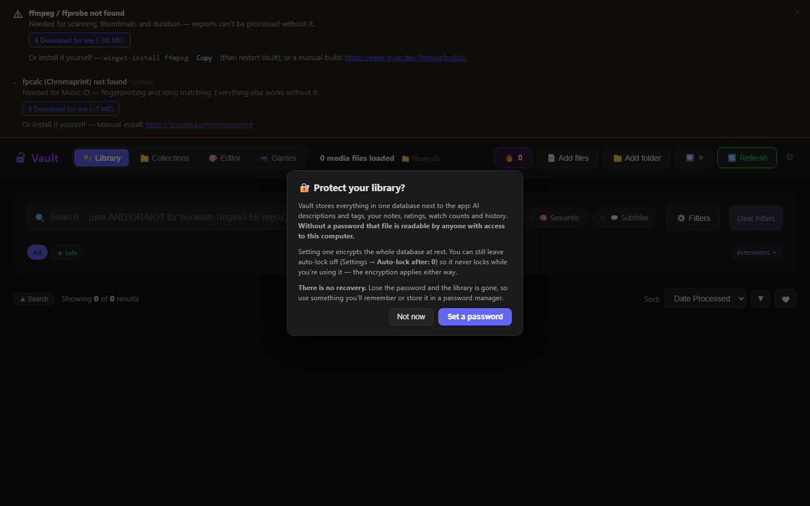
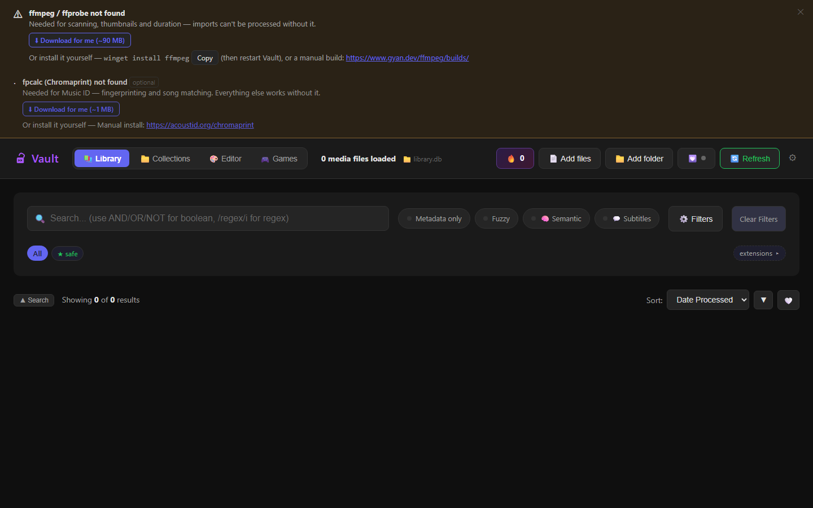
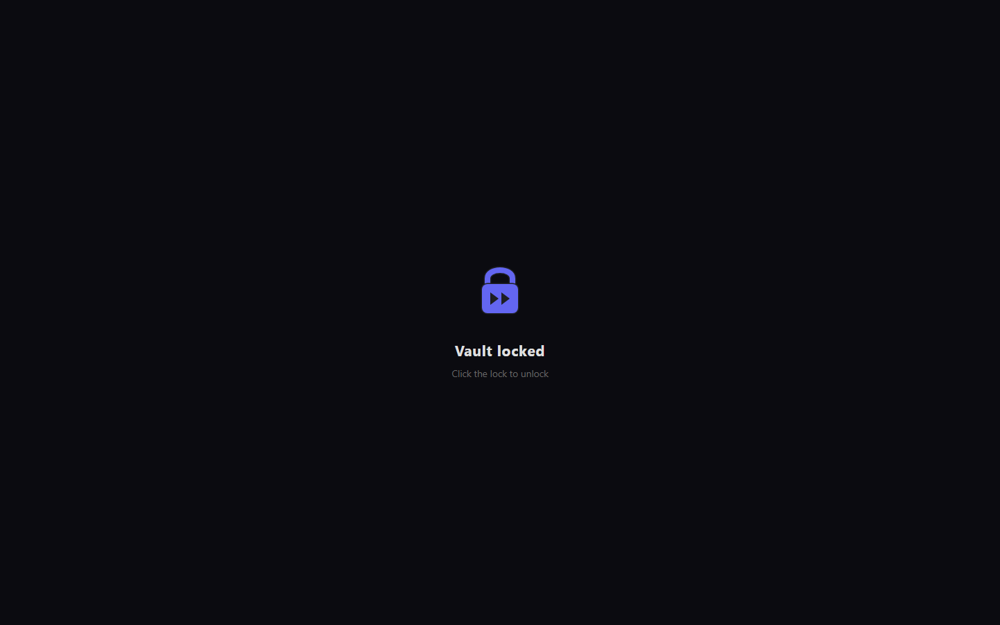

# Vault: Setup & Walkthrough

Everything runs on your machine. Nothing is sent anywhere except your own
local AI server (LM Studio or Ollama).

---

## 1. Quick start (5 minutes)

No installer, no dev tools, nothing to configure. These steps are for
Windows. **On Linux, see [§1b](#1b-linux).**

1. **Download `Vault-v*-win-x64.zip`** from the
   [Releases page](../../releases/latest).
2. **Unzip it anywhere.** It's portable. Everything Vault creates (database,
   thumbnails, trash, models) is written next to the exe, so the whole folder
   can be moved, copied, or backed up wholesale.
3. **Run `Vault.exe`.** The build is unsigned, so Windows SmartScreen warns the
   first time. That's expected: **More info → Run anyway**.
   <!-- TODO screenshot: the two SmartScreen dialogs (initial warn + "Run anyway"
        after More info). Must be taken on a real machine, can't be automated. -->
4. **A console window opens.** That's the server. Leave it open: closing it
   stops Vault. The viewer opens in your browser at
   **http://127.0.0.1:8765**.
5. **First launch offers a password.** Optional: it encrypts the library
   database. There is **no recovery if you lose it**: nobody, including you,
   can unlock the database without it. Skip it and everything else works the
   same.

   

6. **If ffmpeg or fpcalc are missing**, the viewer shows a **⬇ Download**
   banner: one click fetches them next to `Vault.exe` and they work
   immediately, no PATH edits and no restart. (`winget install ffmpeg` works
   too if you'd rather install system-wide.)

   

7. **Add your media** with **📁 Add folder** / **📄 Add files**, or drag files
   onto the window. Files are referenced where they already are; Vault never
   copies or moves them.

That's a working library: browsing, playing, tagging and organizing all work
now. The steps below add the AI features.

### Optional tools (feature-by-feature)

| Tool | Needed for | Install |
|---|---|---|
| **ffmpeg + ffprobe** | thumbnails, duration probing, beat bar, subtitles, Music ID | **one click**: the ⬇ Download banner in the viewer (or `winget install ffmpeg`) |
| **LM Studio** *or* **Ollama** | AI scanning, semantic search, chat-based translation fallback | see §2, step-by-step |
| **fpcalc** (Chromaprint) | Music ID fingerprinting | **one click**: same banner (or [acoustid.org/chromaprint](https://acoustid.org/chromaprint) → PATH) |
| **Face search models** | face search | **one click**: Vault offers them when you turn face search on (see §7) |
| **mpv** | the full Stage (the window you share in Discord); without it Stage runs as Basic, the browser's picture-in-picture (videos only) | install mpv from mpv.io (Vault looks in `C:\Program Files\MPV Player`, `C:\Program Files\mpv`, `C:\Program Files (x86)\mpv` and PATH), or pick `mpv.exe` in Settings › Stage |
| **Python + faster-whisper** | transcription/subtitles | `pip install faster-whisper`, or into a venv, then set `PYTHON_PATH` to that interpreter (see below) |

The ⬇ banner puts the downloaded tools next to `Vault.exe` and they work
immediately: no PATH edits, no restart. It applies to the source checkout
too, where the tools land next to the repo.

**Subtitles are the exception.** They need a Python interpreter plus a pip
package, so there's no single file to drop next to the exe. Press **Generate**
without them and Vault explains exactly what's missing and how to install it.
Vault looks for `faster-whisper` in whichever Python `PYTHON_PATH` names, or
plain `python` from PATH if that's unset, so if you install into a **virtual
environment**, point `PYTHON_PATH` at `…\venv\Scripts\python.exe` or Vault won't
find it. (On Linux and macOS Vault finds a `venv` folder next to itself on its
own, see §1b.)

---

## 1b. Linux

Supported: x64 with Ubuntu 22.04, Debian 12, Fedora 38, Mint 21 or newer
(anything with glibc 2.35 or later), GNOME or KDE, X11 or Wayland.

### Install and run

1. **Download `Vault-v*-linux-x64.tar.gz`** from the
   [Releases page](../../releases/latest).
2. **Extract it and start it** from a terminal:

   ```bash
   tar -xzf Vault-v*-linux-x64.tar.gz
   cd Vault
   ./Vault
   ```

   The terminal is the server. Leave it open: closing it (or Ctrl+C) stops
   Vault and locks the library. The viewer opens in your browser at
   **http://127.0.0.1:8765**. If no browser opens (a headless or minimal
   install), open that address yourself, or start with `./Vault --no-browser`.
3. **"Permission denied"?** The program lost its run permission, which
   happens when the folder is copied through a zip file or a Windows (NTFS or
   exFAT) drive. Fix it with `chmod +x Vault`. Keep the folder on a Linux file
   system (ext4, btrfs, xfs) so the permission sticks.
4. Everything else (password offer, Download banner, adding folders) works as
   in §1. Like on Windows, everything Vault creates lives in this folder.

### Programs from your distro

Vault downloads **ffmpeg, ffprobe and fpcalc** itself (the ⬇ Download banner),
so you can skip them. If you prefer the distro packages:

| Program | Ubuntu, Debian, Mint | Fedora | Arch |
|---|---|---|---|
| ffmpeg + ffprobe (optional) | `sudo apt install ffmpeg` | `sudo dnf install ffmpeg-free` | `sudo pacman -S ffmpeg` |
| fpcalc, for Music ID (optional) | `sudo apt install libchromaprint-tools` | `sudo dnf install chromaprint-tools` | `sudo pacman -S chromaprint` |
| **mpv**, for the full Stage | `sudo apt install mpv` | `sudo dnf install mpv` | `sudo pacman -S mpv` |
| Python, for subtitles | `sudo apt install python3 python3-venv` | `sudo dnf install python3` | `sudo pacman -S python` |

mpv is not downloaded by Vault on Linux: every distro packages it. Use the
distro package, not the Flatpak: Flatpak mpv runs in a sandbox that Vault
cannot start by path.

For subtitles, most distros refuse a plain `pip install` into the system
Python. Make a Python of Vault's own in Vault's folder, which Vault finds by
itself (no `PYTHON_PATH` needed):

```bash
python3 -m venv venv && venv/bin/pip install faster-whisper
```

### Deleting to the Trash

The delete mode **System Trash** (Settings › Library) moves files to your
desktop's Trash, the same one your file manager shows, so you can restore
them there. Files on another drive go to that drive's own Trash folder
(`.Trash-<your user id>` at the top of the drive), as the desktop standard
says. Vault's own **Trash folder** mode works the same as on Windows.

### Stage on Wayland

Ubuntu and Fedora log in to a **Wayland** session by default. Wayland does not
let a program place its own window or keep it on top of others, so the mpv
Stage may open in the middle of the screen and fall behind other windows. If
that matters to you, pick an **X11** or **Xorg** session on the login screen
(the gear icon, before you type your password); Stage then has full control.
Basic Stage (the browser's picture-in-picture) works on both, though on GNOME
Wayland it may not stay on top either.

### Watching big folders (inotify)

Linux limits how many folders one user's programs can watch at once
(`fs.inotify.max_user_watches`). A watched folder with many subfolders can hit
it, and Vault then says the limit is reached. Raise it, for now and after a
restart:

```bash
echo fs.inotify.max_user_watches=524288 | sudo tee /etc/sysctl.d/90-vault.conf
sudo sysctl --system
```

### Moving a library from Windows

Your library (tags, notes, ratings, collections, thumbnails) moves with its
files; nothing needs scanning again.

1. On Windows, empty Vault's trash or restore what you want to keep: files in
   it are recorded under the old Windows folder. Then close Vault.
2. Copy the library files from the Windows Vault folder into the Linux
   `Vault` folder: everything except `Vault.exe`, the `runtime` folder and
   the downloaded tools (`ffmpeg.exe`, `ffprobe.exe`, `fpcalc.exe`). That
   includes `vault.db` (and any `vault.db-wal`, `vault.db-shm` or
   `vault.db-journal` next to it, which can hold recent changes),
   `secure_assets.db`, `vault-settings.json` and the `thumbnails` and
   `models` folders.
3. Make your media reachable on Linux (copy it, or mount the drive).
4. The library still holds Windows paths (`K:\Media\...`). Repoint them with
   the `migrate` command, from the Linux `Vault` folder. Try it with
   `--dry-run` first, which only reports what it would change:

   ```bash
   ./Vault migrate "K:\Media" /mnt/media --dry-run
   ./Vault migrate "K:\Media" /mnt/media
   ```

   A record moves only when its file is really there at the new path. If your
   folders were also renamed or reorganized, `./Vault migrate --relink /mnt/media`
   matches files by name and size instead (see `node vault.js --help`).
   The same two tools are in the viewer: Settings › Library › **Moved your
   files?** (Quick move and Deep search).

A password-protected library moves the same way; unlock it with the same
password on Linux.

Playlists exported on Windows keep their Windows paths and will not match on
Linux. Import them again after the move, or export them again from Linux.

### From source on Linux

See §6. In short:

```bash
sudo apt install build-essential python3     # Fedora: sudo dnf install gcc-c++ make python3
git clone https://github.com/aericocode/Vault.git
cd Vault
ONNXRUNTIME_NODE_INSTALL=skip npm install
./start.sh                                    # or: node vault.js serve
```

Needs Node.js 20 or newer (`node -v`). The build tools matter on **Node 24**:
there are no ready-made SQLite modules for it on Linux, so `npm install`
compiles them. Without build tools the optional encryption module
(`better-sqlite3-multiple-ciphers`) is skipped silently, and then an encrypted
library cannot open and no password can be set; Vault says so and names the
packages to install. Node 22 downloads ready-made modules and needs no build
tools.

### macOS

There is no macOS build and macOS is not supported. Running from source may
work: install the Xcode command line tools (`xcode-select --install`) and
`brew install node ffmpeg mpv chromaprint`, then follow §6 and start with
`./start.sh`. Deleting to the Trash, the Finder's Trash, and opening the
browser work there. Nothing else is tested.

---

## 2. AI backend: LM Studio or Ollama

Vault talks to any **OpenAI-compatible** `/v1/chat/completions` server and
load-balances across several (multi-GPU). Scanning needs a **vision** model.

### Option A: LM Studio (default, zero config), full walkthrough

<!-- TODO screenshots (must be taken in the LM Studio desktop app, can't be
     automated): 1) the download page showing Bionic ABOVE the classic
     "Download LM Studio" section; 2) Model Search with a vision model result;
     3) the Developer-tab load dialog with "manually choose load parameters" ON
     and Context Length set to ~60000; 4) the Developer tab showing
     Status: Running on port 1234. Drop them in images/setup/ and reference
     them at the matching steps below. -->

**1. Install LM Studio, the classic app, not Bionic.**
Download from **[lmstudio.ai/download](https://lmstudio.ai/download#lm-studio-download-heading)**.

> ⚠ The download page lists **"LM Studio Bionic"** (their new agent product)
> *above* the one you want. Scroll to the **"Download LM Studio"** section
> (the one described as *"Chat interface and programmable API"*). Bionic does
> not expose the local server Vault talks to.

Run the installer; on first launch you can skip the onboarding suggestions:
you'll pick your own model next.

**2. Download a vision model.**
1. Open **Model Search** in LM Studio's left sidebar.
2. Search for a model from that fits your VRAM:

| VRAM | Model | Quant |
|---|---|---|
| 6–8 GB | `minicpm-v-4.6-abliterated-max` | `q8_0` |
| 10–12 GB | `qwen3.5-4b-uncensored-hauhaucs-aggressive` | `q4_k_m` |
| 16 GB | `qwen3.5-4b-uncensored-hauhaucs-aggressive` | `q8_0` |
| 24 GB+ | `qwen3.5-9b-uncensored-hauhaucs-aggressive` | `q4_k_m` |

Paste the model name into the search box, then pick the quant from the list on the right when you download it.

4. Pick the appropriate model when offered then hit **Download** and wait for the download to finish.
   


**3. Load it, with a bigger context window.** This is the step everyone misses:
1. Open the **Developer** tab in the left sidebar and load the model from there.
2. Turn on the toggle for **manually choosing load parameters**: without it you
   get the defaults and no chance to change them.
3. Set **Context Length** to **~64000** tokens. The default (~4k) is far too
   small: every scan sends several frames plus the prompt, and a 4k context
   silently truncates them into empty or garbage metadata.
5. **Load the model.**


**4. Start the local server.**
1. Still in the **Developer** tab, make sure **Status** reads **Running**.
2. The port should be **1234** (LM Studio's default, leave it).
3. That's it. Vault's default endpoint is already
   `http://localhost:1234/v1/chat/completions`, and LM Studio serves whatever
   model is loaded: no model name, no API key, nothing to configure in Vault.
4. **Loaded more than one model?** (For example the embedding model for
   semantic search alongside the vision model.) LM Studio then needs to be
   told which one scans should use: Vault pauses the scan and shows a picker
   in the scan panel; choose your **vision** model and it resumes. The choice
   lasts until you close Vault; set `AI_MODEL` to make it permanent.
   

**5. Verify.** Back in Vault, drag a file in (or press ▶ Resume if a scan is
paused waiting for the model). The scan panel should start moving; the file's
description and tags appear when its scan lands.

### Loading more than one copy of a model

More VRAM than one copy needs? Load the same vision model again for more
scan throughput:

1. In LM Studio, load the model a second time (Developer tab, same steps as
   before). The second copy appears in the model list as `name:2`.
2. Back in Vault, no restart needed: press **Refresh** in Settings > Backend,
   or wait up to a minute during a scan.
3. Check **Settings > Backend > Loaded instances** to see both copies
   listed under the same model family, each with its own switch. The table
   mirrors LM Studio: eject a copy there and it leaves the table on the next
   Refresh.

Or let Vault do the loading: in that same table, press **+ Load another
copy** on the family row. The copy gets the same context length, parallel
setting and TTL as the original, and an **Unload** link removes it again.
This needs LM Studio's `lms` command, which LM Studio installs from its
Developer tab (or run `npx lmstudio install-cli`). It only works for the LM
Studio on this PC, not one on another machine.

Two settings control speed here, and they do different things.

A second **worker** keeps each instance busy while the next file's frames are
extracted, so scans stop waiting between files. That is a real gain from 1 to 2,
and little beyond that: an instance still answers one request at a time.

Extra **instances** are more copies of the model loaded in LM Studio, and each
one answers in parallel: three copies, about three times the throughput. Start
with 2 workers per instance, then add as many instances as your VRAM holds,
usually 2 to 4 from 16 GB up.

If you also loaded the embedding model for semantic search, Vault ignores it
here: only vision models are grouped into instances.

### Option B: Ollama

Ollama **requires the model name in each request**, so set two env vars:

```bat
ollama pull qwen3.5-4b-uncensored-hauhaucs-aggressive@q4_k_m  &rem vision model for scanning (see §3)
ollama pull nomic-embed-text      &rem embeddings for semantic search

set LM_STUDIO_URLS=http://localhost:11434/v1/chat/completions
set AI_MODEL=qwen3.5-4b-uncensored-hauhaucs-aggressive@q4_k_m
set EMBEDDING_MODEL=nomic-embed-text
start.bat
```

(Or set them once in System → Environment Variables so start.bat always sees them.
On Linux, use `export NAME=value` instead of `set`, or put the lines in a `.env`
file next to Vault, which works on every system.)

### Multi-GPU

Run one server instance per GPU and list both endpoints:

```
LM_STUDIO_URLS=http://localhost:1234/v1/chat/completions,http://localhost:1235/v1/chat/completions
```

---

## 3. Model recommendations by GPU size

Vision model = scan quality. Quantized (Q4) versions are the sweet spot.

| VRAM | Vision model (scanning) | Quant | Whisper (subtitles) | Notes |
|---|---|---|---|---|
| **6–8 GB** | `minicpm-v-4.6-abliterated-max` | `q8_0` | `WHISPER_MODEL=small` | One instance with 1 worker (CLI: `VISION_WORKERS=1`). Slower but fine. |
| **10–12 GB** | `qwen3.5-4b-uncensored-hauhaucs-aggressive` | `q4_k_m` | `large-v3-turbo` at `int8_float16` (default) | One instance with 2 workers. The defaults target this class. |
| **16 GB** | `qwen3.5-4b-uncensored-hauhaucs-aggressive` | `q8_0` | default | Room for 2 to 4 instances at 2 workers each. |
| **24 GB+** | `qwen3.5-9b-uncensored-hauhaucs-aggressive` | `q4_k_m` | default | Room for 2 to 4 instances at 2 workers each. |

- **Embeddings** (semantic search) are tiny: `nomic-embed-text` (~0.5 GB) runs anywhere.
- **Whisper** sizes: `small` ≈ 1 GB, `large-v3-turbo` int8 ≈ 1.5 GB VRAM; it
  shares the GPU with scans, jobs queue one at a time so they never collide.

---

## 4. Every advanced user-editable setting (defined ONCE, in `config/index.js`)
**Only modify if you know what you are doing.**

All settings live in `config/index.js` and read environment variables;
nothing is duplicated elsewhere (`start.bat` asks the config for the port).

The `VAULT_*` names are current. The former `VIDEO_TAGGER_*` names are still read
as a fallback, so an existing `.env` keeps working.

| Env var | Default | What it does |
|---|---|---|
| `MEDIA_TAGGER_PORT` | `8765` | Viewer port |
| `VAULT_DB` | `./vault.db` | Library database file |
| `VAULT_DB_PASSWORD` | *(none)* | Auto-unlock an encrypted Vault at boot |
| `LM_STUDIO_URLS` | `http://localhost:1234/v1/chat/completions` | AI endpoint(s), comma-separated |
| `AI_MODEL` | *(unset)* | Model name per request, **required for Ollama**, ignored by LM Studio |
| `EMBEDDING_MODEL` | `text-embedding-nomic-embed-text-v1.5` | Semantic-search embedding model |
| `PYTHON_PATH` | Windows: `python` (from PATH). Linux, macOS: `venv/bin/python` next to Vault, then `python3`, then `python` | Which Python runs the transcription / translation / diarization sidecars: point it at `…\venv\Scripts\python.exe` (Windows) or `…/venv/bin/python` (Linux, macOS) if you installed `faster-whisper` into a virtual environment somewhere else |
| `WHISPER_MODEL` | `large-v3-turbo` | Transcription model (`small` for low VRAM) |
| `WHISPER_IDLE_MINUTES` | `5` | `0` = once loaded, Whisper stays loaded; `N` = unload the sidecars after N idle minutes (low-VRAM boxes) |
| `WHISPER_VAD` | `1` | Voice-activity filter: only decode speech, skip music/silence (faster transcription on padded content). `0` to disable |
| `WHISPER_VAD_MIN_SILENCE_MS` | `500` | Minimum silence gap (ms) the VAD treats as a break, raise it if speech gets clipped |
| `SUB_ALLOW_DOWNLOADS` | *(ask per model)* | AI models (whisper + translation packs + speaker-diarization models) already on disk **always** load offline. This governs the one-time fetch of a model that isn't installed yet. Unset, Vault **asks before each individual model** and remembers each answer separately: approving the transcription model does not approve a Japanese translation pack later (Settings → *AI model downloads* lists every model it has needed). `1` = pre-approve everything, no prompts. `0` = never touch the network (missing model errors with instructions; air-gapped / strict mode). `VAULT_OFFLINE=1` forces this off, and the environment always beats the in-app switches |
| `VAULT_OFFLINE` | `0` (unset) | Hard offline switch: `1` = loopback-only networking app-wide (model downloads, update checks, remote AI endpoints all refuse; localhost services keep working). Implies `SUB_ALLOW_DOWNLOADS=0` and sets `HF_HUB_OFFLINE`/`TRANSFORMERS_OFFLINE` for the Python sidecars |
| `VAULT_AUTOLOCK_MINUTES` | `30` | Auto-lock idle timeout (0 = off) |
| `VAULT_TRASH` | `./trash` | Trash folder (opaque filenames) |
| `VAULT_THUMBS` | `./thumbnails` | Thumbnail/cache folder |
| `FRAME_WORKERS` / `VISION_WORKERS` / `PIPELINE_DEPTH` | `4` / `1` / `2` | Scan parallelism (see §3) |
| `VAULT_DISABLE_NATIVE_PICKER` | *(unset)* | `1` = no native Windows dialogs (Windows only): the file pickers, Save As and Choose mpv answer with a message (for test and scratch servers) |
| `VAULT_STAGE_MUTE` | *(unset)* | `1` = Stage (mpv) never makes a sound: it runs with no audio output (test servers) |
| `VAULT_STAGE_TEST_QUIET` | *(unset)* | `1` = checks only: Stage's mpv window opens far off every screen and never takes the focus |
| `VAULT_STAGE_NO_MPV` | *(unset)* | `1` = checks only: mpv is never found, so Stage runs as Basic (picture-in-picture) |

### Running two Vaults

Point a second copy of Vault at a different library and tell the two apart
even while locked: open **Settings > Settings**, set a **port** and an
**instance name**, then restart Vault. The second window's tab and header
show its name, and the lock screen shows it too, before you unlock. The
`MEDIA_TAGGER_PORT` environment variable still wins over the Settings port
when it is set.

---

## 5. Troubleshooting

| Symptom | Fix |
|---|---|
| Double-clicked `Vault.exe` and a window flashed open then vanished | Vault is probably already running: only one server per folder. Open http://127.0.0.1:8765 |
| Windows SmartScreen blocked the app | **More info → Run anyway**. The build is unsigned; the warning is expected |
| `Node.js is required but was not found` | Install Node LTS from nodejs.org, reopen the terminal (§6, source checkout only) |
| `No LM Studio endpoints available` / scan errors instantly | Start LM Studio's server (or Ollama) and check `LM_STUDIO_URLS`; for Ollama also set `AI_MODEL` |
| Scans produce empty/garbage metadata | The loaded model isn't a **vision** model (load one from §3), or its **context length is at the ~4k default**: reload it at ~64k (§2, step 3) |
| `database is encrypted: password required` at boot | The Vault is locked: open the viewer and click the padlock, or set `VAULT_DB_PASSWORD` |
| Thumbnails/duration missing on imports | ffmpeg missing: use the ⬇ banner in the viewer, or install to PATH |
| Music ID says tools missing | fpcalc missing, same ⬇ banner |
| Subtitles fail to generate | Press ▶ Generate. Vault says exactly what's missing. Usually `pip install faster-whisper`; if you used a venv, set `PYTHON_PATH` to its interpreter |
| Diarization/subtitles report that downloads are off | Either pre-install the models (`whisper` / OPUS-MT / `models/diarize` dirs) or set `SUB_ALLOW_DOWNLOADS=1` (and ensure `VAULT_OFFLINE` is unset) |
| Upgraded from v3.5.0 or earlier and the library looks empty | Your old library is still there under its old name. See "Upgrading from v3.5.0 or earlier" just below |
| Linux: `./Vault: Permission denied` | `chmod +x Vault`, and keep the folder on a Linux file system (§1b) |
| Linux: no browser opened | Open http://127.0.0.1:8765 yourself. Vault uses `xdg-open`, which minimal installs lack |
| Linux: Vault says the folder watching limit is reached | Raise `fs.inotify.max_user_watches` (§1b, "Watching big folders") |
| Linux: Stage opens in the wrong place or falls behind other windows | That is Wayland. Use an X11 session for full Stage control (§1b, "Stage on Wayland") |
| Linux, from source: an encrypted library will not open, or no password can be set | The encryption module did not build. Install the build tools (`sudo apt install build-essential python3`), then run `npm install` again (§1b, "From source on Linux") |
| Something else, on any system | Settings › About › **Copy diagnostics** copies your Vault version, system, graphics card and helper programs (no file names). Paste it into your bug report |

### Upgrading from v3.5.0 or earlier

Vault was called video-tagger up to v3.5.0 and kept its library in a file named
`video_metadata.db`. From v3.6.0 that file is called `vault.db`. Nothing is lost
in an upgrade, but Vault looks for the new name, so an older library looks empty
until the file is renamed. This applies only if your first Vault version was
v3.5.0 or earlier.

With Vault closed, in the folder that holds `Vault.exe`:

1. If a `vault.db` is there, it is the empty one Vault just made. Rename it to
   `vault-empty.db` to get it out of the way. Do not delete it yet.
2. Rename `video_metadata.db` to `vault.db`.
3. If files named `video_metadata.db-journal`, `video_metadata.db-wal` or
   `video_metadata.db-shm` are there too, rename each the same way, so
   `video_metadata.db-journal` becomes `vault.db-journal` and so on. They belong
   with the library file and can hold recent changes.
4. Start Vault. Your files, tags and notes are back.

Everything else keeps its name, so `thumbnails`, `trash` and `secure_assets.db`
need no changes. Once you are happy, `vault-empty.db` can be deleted.

If you pointed `VIDEO_TAGGER_DB` at a database somewhere else yourself, that
still works and there is nothing to rename.

The lock screen, for reference: one click on the padlock reveals the password
box:



---

## 6. Run from source (CLI)

For developers, or anyone who'd rather run the Node app directly than the
packaged exe. **These files are in the repository, not in the release zip.**
Clone or download the repo first; the zip contains only `Vault.exe` and its
runtime.

1. **Install [Node.js](https://nodejs.org)** (LTS, version 20 or newer).
   On **Linux with Node 24**, also install the build tools first
   (`sudo apt install build-essential python3`; Fedora:
   `sudo dnf install gcc-c++ make python3`; Arch: `sudo pacman -S base-devel python`):
   `npm install` compiles the SQLite modules there. Without them the
   optional encryption module is skipped and encrypted libraries cannot open.
2. In the repo folder, run **`npm install`** once.
   On **Linux x64**, run it as `ONNXRUNTIME_NODE_INSTALL=skip npm install`
   (same for `npm ci`). Otherwise the face-search runtime (onnxruntime-node)
   also downloads its NVIDIA CUDA add-ons, several hundred MB that Vault never
   uses (face search runs on the CPU, see §7). Windows and macOS skip this by
   themselves.
3. Double-click **`start.bat`** (Windows) or run **`./start.sh`** (Linux,
   macOS): it starts the local server and opens the viewer in your browser
   (same UI, same `http://127.0.0.1:8765`).
4. **Drag media files onto the window** to add them (playable immediately),
   or run **`scan.bat`** (`./scan.sh` on Linux and macOS) for the interactive
   wizard that indexes whole folders:
   pick a directory (it remembers your history), toggle options with the arrow
   keys, go. It prints the equivalent flag command before each run.

Flag-style usage works everywhere:

```bash
node vault.js scan /path/to/media --recursive --all-types
node vault.js serve            # same as start.bat / ./start.sh
node vault.js status           # library stats
node vault.js migrate <old> <new> --dry-run   # repoint moved files (see §1b)
```

Everything in §2–§5 applies unchanged: the source checkout and the exe read
the same environment variables and talk to the same AI backends. The only
difference is where app data lands: next to the repo instead of next to
`Vault.exe`.


---

## 7. Face search

Click a face in a file's info and Vault shows every file that person is in.
You can also search with a photo of someone, or with a paused video frame.
The 👤 Faces tab sorts everyone Vault finds into people you can name, merge
and play. Everything runs on your computer, and face search is off until you turn it on.

### Turn it on

1. Open **⚙ Settings > Face search** and switch on **Face search**.
2. Vault asks to download three face search models (about 213 MB) from
   Hugging Face. Click **Download**. This happens once, and face search works
   offline after that.

The models are YuNet (finds faces) and SFace (tells people apart) from the
OpenCV model zoo, released under the MIT and Apache-2.0 licenses, plus the
AdaFace IR50 matching model (the Standard face model, about 174 MB of the
total). Switching to the **Best** face model in Settings downloads AdaFace IR101
instead (about 261 MB). The AdaFace models state no license of their own (MIT
code, research-use training data).

### Check your files for faces

Vault looks through each photo, GIF or video once, then remembers the faces it
found. Pick whichever way suits you:

- **One file:** open its info and click **Find faces in this file** under
  👤 People, or right-click its tile and choose **Find faces in this file**.
- **Some files:** select them and click **👤 Find faces (N)** in the selection
  bar, or right-click one of the selected tiles.
- **Everything:** click **Find faces in everything** in Settings > Face search.
  Once some files are checked, the button reads **Find faces in the rest**.
  Progress shows there, with **Pause** and **Stop**.
- **New files:** turn on **Find faces in new imports automatically**. New
  photos and videos are checked after their normal AI scan.

Videos are checked at regular spots. Two settings in Settings > Face search
control how:

- **How closely to check videos** sets the spacing: **Every 2 seconds**,
  **Every 3.5 seconds** (the default) or **Every 10 seconds**. Pick **Custom**
  to type your own, from 0.5 to 120 seconds. Closer checks find more faces,
  including people who are only on screen briefly, but take longer.
- **Most frames per video** caps how many spots one video gets (100 to
  20,000, default 2,000). Longer videos spread these frames evenly, so a very
  long video is checked more loosely than the spacing above. More frames find
  more faces but take longer.

A change applies to files checked from then on. Files already checked keep
their results. To recheck a file, right-click its tile and choose **Look for
faces again**.

### Search for a person

- **Click a face.** The people found in a file show as small face pictures
  under 👤 People in its info. Click one to see every file that person is in,
  best match first. In the player, the video shrinks to the mini player so
  you can see the results.
- **Choose how strict.** The bar above the results has three buttons:
  - **Close matches**: only files that are very likely the same person. Some
    real matches may be left out.
  - **Normal** (the default): a good balance.
  - **Cast a wider net**: finds more, including blurry or turned faces, but
    also shows more of the wrong people.

  Click **Clear results** to go back to your whole library.
- **👤 Find a person** (at the end of the filter row): drop a photo in the box,
  choose one, or paste one with Ctrl+V. If the photo has more than one face,
  Vault asks **Which person?**. The photo is only used for this search and is
  not kept.
- **Find people in this frame**: while a video plays, click the 👤 button in
  the player controls. Vault pauses and looks for faces at that moment. The
  video does not need to be checked first.

### The Faces tab

Click **👤 Faces** at the top of Vault to see everyone in your library. If
face search is off, the tab shows **Turn on face search** instead.

- **People appear on their own.** As files are checked, Vault sorts the faces
  into people. Each person gets a tile with their photo, how many files they
  are in and, for videos, about how long they are on screen.
- **Find and sort.** Search by name, or use the chips: **Everyone**,
  **Named**, **Not named yet**, **★ Favorites**, **In only one file** and
  **Hidden**. Sort by **Most files**, **Most time on screen**, **Recently
  added** or **Name A to Z**.
- **Name someone.** Click **Add a name** under their tile. If you pick a name
  someone else already has, Vault asks if they are the same person. Choose
  **Yes, put them together** or **No, someone else**.
- **Same person?** When Vault is not sure two people are the same, it asks in
  a strip at the top. Click **Yes** or **No**, or **Review all** to go through
  them one by one. Your answers are remembered.
- **Merge and hide.** Select tiles (a checkbox shows when you hover) to
  **Merge into** one person, or to **Hide** people you don't care about.
  Hidden people stay out of Everyone, and their new faces stay hidden too.
  Find them under **Hidden** and click **Unhide** to bring them back.
- **In only one file** shows people Vault has seen just once. These are often
  extras or strangers, which makes them quick to hide.

Click a tile to open that person's page:

- **▶ Play all** or **Shuffle** plays their files. Videos start where the
  person first shows up, and their tiles show a badge like **▶ from 0:21**.
- **★ Favorite** adds them to ★ Favorites and puts them first when sorting
  by Most files.
- **Find more that might be them** runs a wider face search to catch files
  Vault missed.
- **Change photo** picks the face shown on their tile. **More** has **Hide
  this person** and **Merge with...**.
- **Often seen with** shows the people who share the most files with them.
- **All**, **Videos** and **Photos** narrow the files shown.
- Wrong file? Hover its tile and click **✕ Not this person**. Click **Undo**
  in the message that appears if you change your mind.

Your fixes always stick. Vault never undoes a name, merge or "Not this
person", even when a file is checked again.

### Privacy

- Face search runs entirely on this computer. Nothing is uploaded. The only
  download is the two models, once.
- Faces are stored in your library. If your library has a password, they are
  encrypted with it like everything else.
- **Delete all face data** (the **Delete** button under Face data in
  Settings > Face search) removes every face and person Vault found,
  including names. Click it a second time to confirm. Your files are not
  touched.
- **Hide this face** (right-click a face picture) removes that face from
  search. In this version it cannot be undone, other than by deleting all face
  data. Hiding a whole person in the Faces tab is different: **Unhide** brings
  them back.

### Limits

- Very small or far-away faces, and faces turned to the side, may be missed.
- About 20 photos are checked per second. A 2-hour video takes roughly 1 to 2
  minutes.
- The first check of a big library can take hours. It runs in the background
  and you can pause it at any time. If you close Vault part way, click **Find
  faces in the rest** next time to carry on.
- Running from source on Linux? See the `npm install` note in §6.

---

## 8. Keyboard shortcuts

Press **?** anywhere in Vault for the full list, with the group for where you are marked **You are here**. The same list is in **Settings > Keyboard shortcuts**.

Most keys do nothing while you are typing in a box (search, notes, a name), so typing never sets anything off by accident. A few still work there on purpose: Esc, Alt+Left and Alt+Right in the player, and Ctrl+Shift+H.

Number keys: in the player, **0** to **9** jump through a video or audio file (0 is the start, 1 is 10%, 5 is halfway, 9 is 90%). On a picture, **0** resets the zoom and turn. Holding Ctrl or Alt leaves them to the browser, so Ctrl+0 still resets the page zoom.
